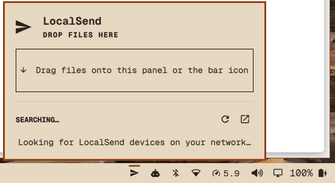

# LocalSend Drop

An Omarchy bar widget for sending files to nearby [LocalSend](https://localsend.org) devices. Drag files onto the bar icon, pick a receiver, and the files go straight over your local network. You don't need to open the LocalSend app.



## Install

```sh
omarchy plugin add https://github.com/dumbld0re/omarchy-localsend-drop.git --enable
```

Or open **Settings → Plugins**, enable **LocalSend Drop**, and place it in a bar section.

## Use

- **Drag files** onto the bar icon. The panel opens and searches for devices.
- **Click** the icon to open the panel. **Right-click** opens the LocalSend app.
- Pick a device to send. Each device shows the first 8 characters of its LocalSend fingerprint; compare them with the fingerprint in the receiver's LocalSend settings if you want to be sure it's the right device. The receiver accepts on their side, and the panel shows upload progress.
- Devices that only offer unencrypted HTTP are marked **unencrypted**. Picking one asks for confirmation; pick it again to send anyway.
- From scripts: `omarchy-shell danny-miguel.localsend-drop send /path/to/file`.

Setting: **Device search time** (3–30 s, default 8).

## How it works

`bin/lsdrop.py` is a small LocalSend v2 client written with only the Python standard library. It finds devices two ways at once: the LocalSend multicast announcement (`224.0.0.167:53317`) and a direct `/info` probe of the local /24, which still works when multicast is filtered. It sends over HTTPS. LocalSend receivers use self-signed certificates, so instead of a CA check the client pins the receiver's [LocalSend fingerprint](https://github.com/localsend/protocol/blob/main/README.md#2-fingerprint), the SHA-256 of its certificate:

- During discovery, devices found by the direct probe are identified by the certificate they actually present, not the fingerprint they claim.
- When sending, the TLS connection is checked against the fingerprint of the device you picked right after the handshake. If it doesn't match, the connection is closed before any file names, metadata or file bytes are sent.
- Plain HTTP is only used after you confirm it, as described above.
- Response bodies from other devices are size-capped (64 KB for discovery and upload replies, 1 MB for the transfer setup), so a device on the network can't exhaust memory.

It writes one thing outside the plugin folder: a self-signed client certificate, saved to `~/.local/state/lsdrop/`.

## Dependencies

- `python3` and `openssl` (included with Omarchy)
- A LocalSend app on the receiving device. Installing LocalSend on this machine is optional; it's only needed for the right-click shortcut and for receiving files.

## Remove

```sh
omarchy plugin remove danny-miguel.localsend-drop
rm -rf ~/.local/state/lsdrop
```

## License

MIT © Danny-Miguel
